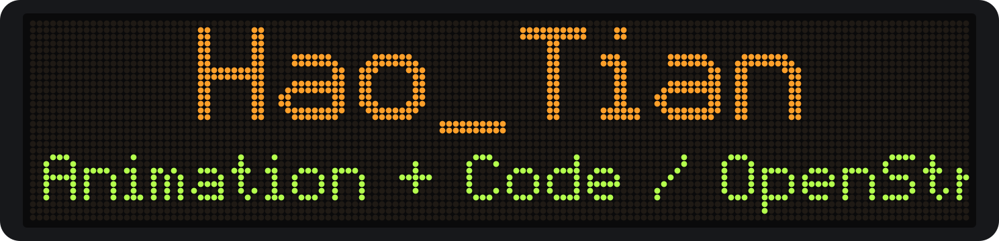
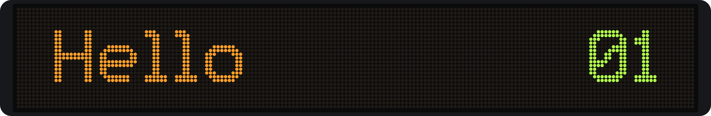
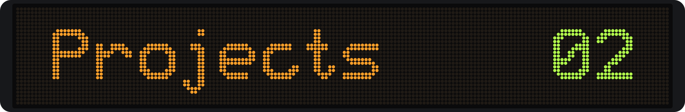
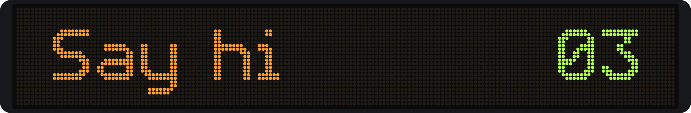

### 

I'm Hao_Tian. Most of the code here started with a small question or a small annoyance in daily life.

- Studying animation and interactive media, and writing code along the way
- Volunteering as an OpenStreetMap mapper
- Interested in public transit and its role in sustainable cities
- Going on city walks
- Playing badminton

### 

**Getting around**
- [TU-Reader](https://github.com/HaoTian22/TU-Reader): what is actually stored on your transit card?
- [GDIC-DepartureBoard](https://github.com/HaoTian22/GDIC-DepartureBoard): an intercity departure board in HTML and JS

**Maps**
- [BNBU-Map](https://github.com/HaoTian22/BNBU-Map): my campus, mapped by the people who walk it

**Small tools**
- [HT-Music-Downloader](https://github.com/HaoTian22/HT-Music-Downloader) · [lucky_farmer](https://github.com/HaoTian22/lucky_farmer) · [UIC-Utilities](https://github.com/HaoTian22/UIC-Utilities)

<b>&gt;&gt;&gt; GitHub stats</b>

### 

More of my work, including animation and 3D, is at **[haotian22.top](https://haotian22.top/)**. English or 中文 both work.
